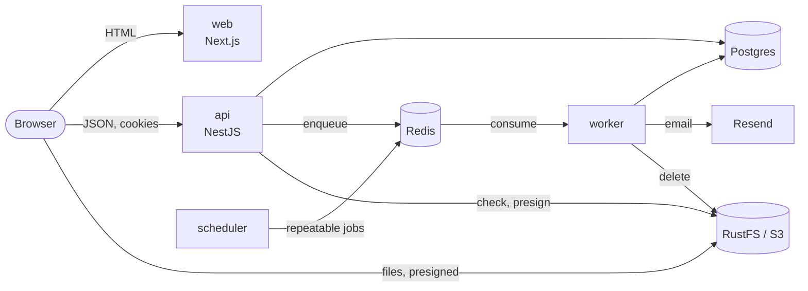

# template-application-prod-ready

A production-ready foundation: a NestJS api, a BullMQ worker and scheduler, and a Next.js web app,
in one Nx monorepo running on Bun. Business rules live in bounded contexts with enforced layers;
apps only compose them.

The proof of concept: registration, sign-in, email verification and password reset (emails via
Resend, in the user's language), avatars uploaded straight to S3-compatible object storage
(RustFS locally), and a "test connection to the API" card.



## Quickstart

Requires Bun 1.4.2, Node 24 and Docker.

```sh
bun install
cp .env.example .env        # then set RESEND_API_KEY, or MAIL_TRANSPORT=console to log emails
bun run docker:up           # Postgres 17, Redis 7, RustFS (S3 API :9000, console :9001)
bun run db:deploy           # apply migrations
bun run storage:provision   # create the bucket, its CORS and lifecycle rules
bun run dev                 # api :4000, worker, scheduler, web :3000
```

Open http://localhost:3000. The api serves Swagger at http://localhost:4000/docs and, for ADMIN
users, Bull Board at http://localhost:4000/admin/queues. The RustFS console is at
http://localhost:9001/rustfs/console/ (`S3_ACCESS_KEY_ID` / `S3_SECRET_ACCESS_KEY` from `.env`).

## Everyday commands

| Task                        | Command                                                 |
| --------------------------- | ------------------------------------------------------- |
| Unit tests, lint, typecheck | `bunx nx affected -t lint typecheck test`               |
| Integration tests           | `bun run test:int` (needs `docker:up`)                  |
| Bucket, CORS, lifecycle     | `bun run storage:provision` (idempotent)                |
| End-to-end suites           | `bunx nx e2e api-e2e`, `bunx nx e2e web-e2e`            |
| New migration               | `bun run db:migrate`                                    |
| OpenAPI document            | `bun run openapi`                                       |
| Repository checks           | `bun run check:structure`, `bun run check:server-logic` |
| Dependency graph            | `bunx nx graph`                                         |

The pre-commit hook formats, checks the structure and runs the affected typechecks and tests;
commit messages follow Conventional Commits.

## Layout

```
apps/                  api · worker · scheduler · web · api-e2e · web-e2e
packages/shared/       contracts (routes, schemas, error codes) · i18n (en, fr)
packages/frontend/     ui (design system) · api-client
packages/platform/     config · logger · database · redis · storage · queue · messaging · http · health · ddd · testing
packages/contexts/     identity · notifications, one package per layer
docs/                  adr · architecture · guides · agents
```

Each app and context has a README saying what it owns. Start with:

- [`CONTEXT.md`](./CONTEXT.md): the contexts, their language and how they talk.
- [`docs/architecture/boundaries.md`](./docs/architecture/boundaries.md): who may import whom, and why.
- [`docs/architecture/conventions.md`](./docs/architecture/conventions.md): where each kind of file goes.
- [`docs/guides/`](./docs/guides/): recipes to add a context, a command or query, a job or schedule,
  a frontend feature, a locale, and to store files.
- [`docs/adr/`](./docs/adr/): the decisions a newcomer would otherwise question.

## Deploying

Each app ships as an image built from the repository root (`apps/<app>/Dockerfile`); the api
Dockerfile's `migrator` target runs `prisma migrate deploy` as a one-shot job before a release.
The api and worker need an S3-compatible bucket (`S3_*` variables), provisioned once per
environment: credentials, CORS and lifecycle in
[`docs/guides/store-files.md`](./docs/guides/store-files.md#production).
The web image takes `NEXT_PUBLIC_API_URL` and `NEXT_PUBLIC_SITE_URL` as build args. Probes:
`/health/live` and `/health/ready` on the api, `:WORKER_HEALTH_PORT` and `:SCHEDULER_HEALTH_PORT`
for the worker and scheduler.
