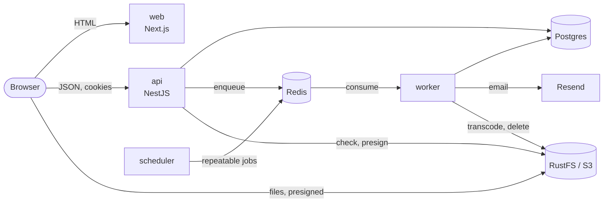

# template-application-prod-ready

A production-ready foundation: a NestJS api, a BullMQ worker and scheduler, and a Next.js web app,
in one Nx monorepo running on Bun. Business rules live in bounded contexts with enforced layers;
apps only compose them.

The proof of concept: registration, sign-in, email verification and password reset (emails via
Resend, in the user's language), avatars and videos uploaded straight to S3-compatible object
storage (RustFS locally), videos transcoded by the worker into one H.264 file every phone plays,
and a "test connection to the API" card.



## Quickstart

Requires Bun 1.4.4, Node 24, Docker, and ffmpeg (with libx264 and zimg, as Debian, Ubuntu and
Homebrew build it) for the worker's video transcoding.

```sh
bun install
cp .env.example .env        # then set RESEND_API_KEY, or MAIL_TRANSPORT=console to log emails
bun run docker:up           # Postgres 17, Redis 7, RustFS (S3 API :9000, console :9001)
bun run db:deploy           # apply migrations
bun run storage:provision   # create the bucket, its CORS and lifecycle rules
bun run dev                 # api :4000, worker, scheduler, web :3000
```

Or everything in containers, sources synced in as you edit: `bun run docker:dev`
([run with Docker](./docs/guides/run-with-docker.md)). Every service has a fixed address on
192.168.250.0/24, which the server-side URLs of `.env` use: from the host they are reachable on
Linux only, so on Docker Desktop point host-run tools at the localhost ports instead.

Open http://localhost:3000. The api serves Swagger at http://localhost:4000/docs and, for ADMIN
users, Bull Board at http://localhost:4000/admin/queues. The RustFS console is at
http://localhost:9001/rustfs/console/ (`S3_ACCESS_KEY_ID` / `S3_SECRET_ACCESS_KEY` from `.env`).

## Everyday commands

| Task                        | Command                                                       |
| --------------------------- | ------------------------------------------------------------- |
| Unit tests, lint, typecheck | `bunx nx affected -t lint typecheck test`                     |
| Integration tests           | `bun run test:int` (needs `docker:up`)                        |
| Bucket, CORS, lifecycle     | `bun run storage:provision` (idempotent)                      |
| End-to-end suites           | `bunx nx e2e api-e2e`, `bunx nx e2e web-e2e`                  |
| New migration               | `bun run db:migrate`                                          |
| OpenAPI document            | `bun run openapi`                                             |
| Migrations match the schema | `bunx nx run database:prisma-check-drift` (needs `docker:up`) |
| Everything in containers    | `bun run docker:dev` (stop with `bun run docker:down`)        |
| Boot a production image     | `bun tools/scripts/smoke-test-image.ts api <image>`           |
| Boot the production stack   | `bun tools/scripts/smoke-test-stack.ts` (Linux host)          |
| Repository checks           | `bun run check:structure`, `bun run check:server-logic`       |
| Update the agent skills     | `bun run skills:sync` (weekly pull request otherwise)         |
| Dependency graph            | `bunx nx graph`                                               |

The pre-commit hook formats, checks the structure and runs the affected typechecks and tests;
commit messages follow Conventional Commits. CI runs the same checks on what a pull request
affects, plus the integration and e2e suites, and boots and scans every affected image; one check,
`CI OK`, gates the merge ([ADR 0014](./docs/adr/0014-ci-checks-what-changed-and-boots-the-images-that-ship.md)).

## Layout

```
apps/                  api · worker · scheduler · web · api-e2e · web-e2e
packages/shared/       contracts (routes, schemas, error codes) · i18n (en, fr)
packages/frontend/     ui (design system) · api-client
packages/platform/     config · logger · database · redis · storage · queue · messaging · http · health · ddd · testing
packages/contexts/     identity · media · notifications, one package per layer
docker/                dev/ and prod/: one image per service (images/), its config (config/)
docs/                  adr · architecture · guides · agents
```

Each app and context has a README saying what it owns. Start with:

- [`CONTEXT.md`](./CONTEXT.md): the contexts, their language and how they talk.
- [`docs/architecture/boundaries.md`](./docs/architecture/boundaries.md): who may import whom, and why.
- [`docs/architecture/conventions.md`](./docs/architecture/conventions.md): where each kind of file goes.
- [`docs/guides/`](./docs/guides/): recipes to add a context, a command or query, a job or schedule,
  a frontend feature, a locale, to store files, to run with Docker, and to cut a release.
- [`docs/adr/`](./docs/adr/): the decisions a newcomer would otherwise question.

## Deploying

Merging the release pull request that release-please keeps open publishes every image to GHCR,
versioned from the Conventional Commits and attested: see
[`docs/guides/cut-a-release.md`](./docs/guides/cut-a-release.md).

`docker-compose.prod.yaml` runs the whole stack on one host behind a Cloudflare Tunnel:
cloudflared → nginx → web, api and object storage, with Postgres, Redis and RustFS beside them and
no published port. Images are distroless (the database aside), run as non-root with a read-only
root filesystem and no Linux capability, and get only the `.env` keys they read. The `migrator`
runs `prisma migrate deploy` and provisions the bucket before the api and worker start, on every
release. See [run with Docker](./docs/guides/run-with-docker.md#production) and
[ADR 0015](./docs/adr/0015-docker-runs-every-service-on-fixed-addresses.md).

Each image builds from the repository root (`docker/prod/images/<service>.prod.dockerfile`). The
web image takes `NEXT_PUBLIC_API_URL` and `NEXT_PUBLIC_SITE_URL` as build args. Probes:
`/health/live` and `/health/ready` on the api, `:WORKER_HEALTH_PORT` and `:SCHEDULER_HEALTH_PORT`
for the worker and scheduler.
